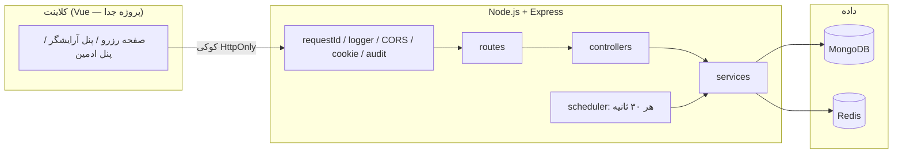
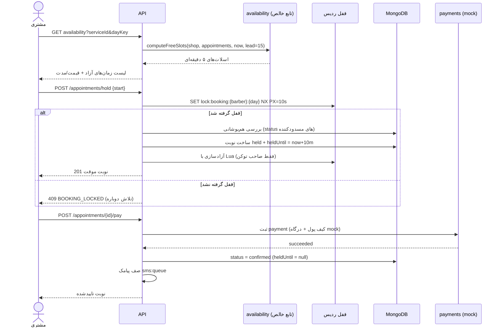
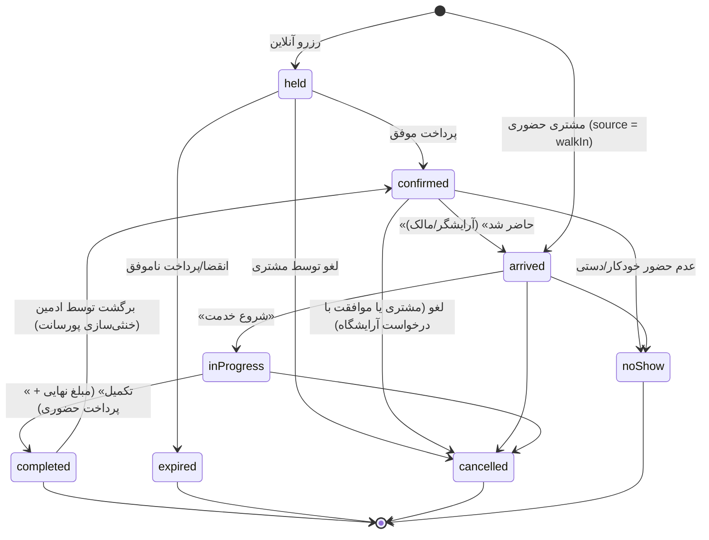
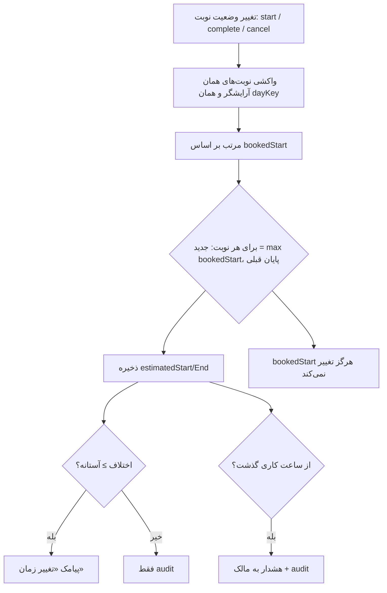
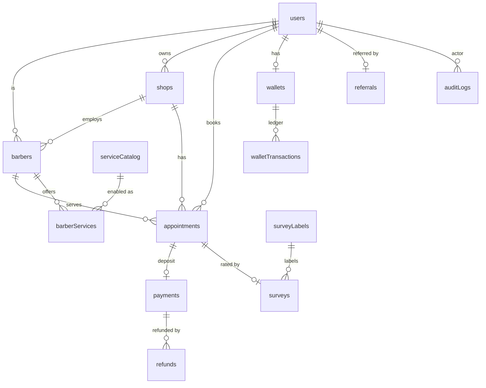

# معماری بک‌اند

این سند ساختار، جریان‌های اصلی و مدل داده سرور را خلاصه می‌کند. قواعد کسب‌وکار در
[`README.md`](../README.md) و مسیرها در [`API.md`](API.md) آمده‌اند.

## ۱) نمای کلی اجزا



- **controllers** فقط HTTP هستند (اعتبارسنجی ورودی + پاسخ)؛ منطق دامنه در **services**.
- **helpers** مشترک‌اند: `time.js` (تنها نقطه تبدیل UTC ↔ تهران)، `serialize.js` (شکل پاسخ)،
  `AppError.js`، `roles.js`، `mobile.js`، `auditEntry.js`.
- **scheduler** در همان پروسه اجرا می‌شود و با `setInterval` کارهای دوره‌ای را انجام می‌دهد؛
  عملیاتش idempotent است، پس اجرای دوباره یا چند نمونه سرور اثر تکراری نمی‌گذارد.

## ۲) جریان رزرو آنلاین



قفل فقط «بررسی و ثبت» را می‌پوشاند (چند میلی‌ثانیه)؛ نه کل مدت پرداخت. اگر قفل منقضی شود،
بررسی هم‌پوشانی داخل قفل بعدی جلوی تداخل را می‌گیرد و ایندکس‌های یکتای جزئی سد کمکی هستند.

## ۳) ماشین وضعیت نوبت



- `walkIn` هرگز `held` نمی‌شود و بیعانه ندارد.
- `noShow` برای رزرو آنلاین مسدودکننده است ولی بازه‌اش برای مشتری حضوری آزاد می‌ماند.
- مهلت «نگه‌داشتن تصمیم عدم حضور» تا شروع نوبت بعدی همان آرایشگر است.

## ۴) محاسبه زمان پیش‌بینی‌شده



## ۵) کیف پول و پورسانت

```mermaid
flowchart LR
  A[تکمیل خدمت: finalPrice] --> B{مشتری معرف دارد؟}
  B -- بله --> C[commission = finalPrice × درصد پورسانت]
  C --> D[walletTransactions: commission:{appointmentId} برای معرف]
  C --> E[walletTransactions: platform منفی]
  F[ادمین: برگشت تکمیل] --> G[walletTransactions: commission-reversal:{appointmentId}]
  H[لغو به‌موقع] --> I[refunds + depositRefund به کیف پول]
  J[پرداخت بیعانه] --> K[spend از کیف پول + درگاه mock]
```

هر تراکنش `idempotencyKey` یکتا دارد؛ درخواست تکراری (retry کلاینت یا اجرای دوباره job) اثر
دوباره نمی‌گذارد. موجودی کیف پول هرگز منفی نمی‌شود.

## ۶) داده‌ها

### MongoDB (ER)



| کالکشن | نکات کلیدی |
|---|---|
| `users` | یک موبایل = یک کاربر؛ `roles` سراسری؛ `referralCode` یکتا؛ `referredBy` تغییرناپذیر |
| `shops` | `settings.workingHours` (weekday 0=شنبه)، `holidays`، `showPricesToGuests`، `license` غیرفعال |
| `barbers` | کاربر + آرایشگاه + `isOwner`؛ ایندکس یکتای جزئی: یک آرایشگر فعال به‌ازای هر کاربر، یک مالک فعال به‌ازای هر آرایشگاه |
| `serviceCatalog` | `titleKey` نرمال‌شده یکتا؛ چرخه وضعیت `active → removing → archived` |
| `barberServices` | قیمت/مدت هر آرایشگر؛ `isActive` فقط با هر دو مقدار |
| `appointments` | `bookedStart/End` تغییرناپذیر، `estimatedStart/End` محاسبه‌ای، `priceSnapshot/durationSnapshot`، `heldUntil`، `cancelRequest`، ایندکس `one_hold_per_customer` |
| `payments` | `walletAmount + gatewayAmount === amount`؛ `idempotencyKey` یکتا |
| `refunds` | موجودیت جدا؛ مقصد `wallet` (فوری) یا `bank` (mock)؛ `idempotencyKey` یکتا |
| `wallets` / `walletTransactions` | دفتر کل فقط افزودنی؛ حساب `user` و `platform` |
| `referrals` | `refereeId` یکتا (هر کاربر یک معرف) |
| `surveys` / `surveyLabels` | یک نظرسنجی برای هر نوبت؛ لیبل‌های فعال از فهرست سراسری |
| `settings` | تک‌سند `key=global` با تنظیمات کسب‌وکار |
| `auditLogs` | فقط افزودنی؛ update/delete در سطح mongoose مسدود است |

### Redis

| کلید | کاربرد | TTL |
|---|---|---|
| `lock:booking:{barberId}:{dayKey}` | قفل کوتاه رزرو | ۱۰ ثانیه |
| `sms:queue` | صف پیامک (list)؛ شکست ارسال ⇒ حداکثر ۳ تلاش | — |
| `sms:sent:{idempotencyKey}` | جلوگیری از پیامک تکراری | ۷ روز |
| `otp:code:{mobile}` / `otp:tries` / `otp:cooldown` | احراز هویت | ۱۲۰ / ۱۲۰ / ۶۰ ثانیه |
| `session:{token}` | نشست کوکی | `SESSION_TTL_DAYS` |

## ۷) کارهای دوره‌ای (scheduler)

هر ۳۰ ثانیه:

1. `expireHolds` — نوبت‌های `held` که `heldUntil` گذشته‌اند → `expired` (بازه آزاد می‌شود).
2. `sendDueReminders` — یادآوری پیامکی یک ساعت قبل از نوبت تاییدشده (کلید یکتا).
3. `markNoShows` — ۵ دقیقه بعد از زمان پیش‌بینی‌شده → `noShow`، با احترام به `noShowHold`.
4. پردازش حداکثر ۲۰ پیام از `sms:queue`.

`POST /api/admin/jobs/expire-holds` و `POST /api/admin/jobs/no-show` اجرای دستی همین کارها هستند.

## ۸) خطاها و امنیت

- همه خطاها در `errorHandler` نرمال می‌شوند: `AppError` ⇢ همان کد/پیام؛ خطای Mongoose ⇢ ۴۲۲/۴۰۹؛
  ناشناخته ⇢ ۵۰۰ عمومی (بدون نشتی جزئیات در production).
- نشست با کوکی `HttpOnly` + `SameSite=Lax` و `Secure` در production؛ توکن در ردیس.
- هر مسیر پنل هم نقش و هم تعلق به همان آرایشگاه را بررسی می‌کند (`requireRole` + `requireShopAccess`
  و بررسی در سرویس‌ها).
- `auditLogs` برای همه تغییرهای وضعیت و تنظیمات نوشته می‌شود؛ کالکشن فقط افزودنی است.
- OTP: کد هش‌شده در ردیس، یک‌بارمصرف، محدودیت تلاش و فاصله ارسال.
